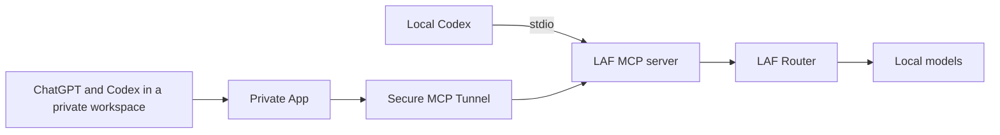

<!--
KISS Open License Version 1.0 (KOL-v1)

SPDX-FileCopyrightText: 2026 I-plusplus Inc.
SPDX-License-Identifier: LicenseRef-KOL-v1

Copyright remains with its respective holders; original copyright and attribution notices must be preserved.
Contributors may add copyright notices for their own original modifications.
Distributed modifications must be identified as required by Section 4(c) of KOL-v1.

Use, modification, distribution, and incorporation into commercial or proprietary software are permitted
without license fees or source disclosure, subject to all terms of the complete KOL-v1 license.

Contributors grant the patent permissions stated in KOL-v1. Outputs are not covered merely because a
KOL-licensed tool produced them; embedded licensed material remains subject to applicable license terms.

THIS SOFTWARE IS PROVIDED "AS IS", WITHOUT WARRANTY OR LIABILITY TO THE EXTENT PERMITTED BY APPLICABLE LAW.

This header is a summary, not a separate license or an amendment to KOL-v1.
All terms and conditions of KOL-v1 apply. See the accompanying LICENSE file for the complete license text.

Scope: This notice applies only to the project-authored metadata or documentation in this exact file. External material it describes retains its separate terms.
-->

<!-- Modified 2026-11-09: add the checkout-local interactive chat guide. -->

<!-- Modified 2026-11-10: redesign the landing page, document the default chat entrypoint, and move source-preview and test details into docs. -->

<!-- Modified 2026-11-10: link client-only packaging while retaining the separate runtime-provisioning boundary. -->

<!-- Modified 2026-11-22: summarize requirements and the two source setup paths. -->

# Local AI Fabric

**Your hardware. Your models. Your AI.**

Local AI Fabric (LAF) lets Codex and ChatGPT use models running on your own
hardware. The LAF Router serves the models you configure through a private
connection.

`0.0.1` is an experimental source preview. Public one-click plugin installation
is unavailable for this version.

## Requirements

- A Linux host for the documented setup and Python 3.12 or later for the LAF
  runtime.
- [MCP SDK 1.30.0](docs/laf-sdk-install.md) for the plugin frontend. The SDK
  installer supports CPython 3.12 and 3.14 on Linux x86_64.
- RAM and disk space for the model you choose. The
  [CPU-only Router](docs/laf-configured-models.md#explicit-cpu-only-router)
  uses local Docker, a digest-pinned Ollama image, and an installed model pinned
  by its manifest digest. This path can run without a GPU.

## Architecture



See the [component guide](docs/public-source-component-guide.md) for the
standalone client and other components.

## Set up from source

1. Check out the experimental source tag.

   ```sh
   git clone --branch 0.0.1 --single-branch https://github.com/i-pp/laf.git
   cd laf
   ```

2. [Select or install a model](docs/laf-model-management.md#model-setup-from-the-local-ai-fabric-plugin)
   and [configure and start its Router](docs/laf-configured-models.md).
   Keep weights in persistent storage outside the plugin. Install the SDK, then
   [prepare a private LAF runtime and bind it to the Router](docs/bootstrap.md).
3. Choose a connection.
   - **Local Codex.** Follow the [local marketplace instructions](docs/codex-install.md#codex-local-marketplace-option)
     to install the source-built plugin and connect over stdio.
   - **Private workspace.** Follow the [workspace setup guide](docs/integrated-plugin-install.md#private-workspace-setup-for-001)
     to connect ChatGPT and Codex through one private App and its Secure MCP
     Tunnel.
4. With the Router running, use `laf_router_status` in the connected plugin or
   run this command from the checkout with your Router's socket path.

   ```sh
   ./laf --socket /absolute/owner-private/router/service.sock status
   ```

   Look for `ready` in the returned status.
