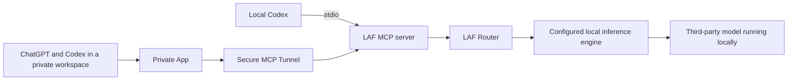

<!--
KISS Open License Version 1.0 (KOL-v1)

SPDX-FileCopyrightText: 2026 I-plusplus Inc.
SPDX-License-Identifier: LicenseRef-KOL-v1

Copyright remains with its respective holders; original copyright and attribution notices must be preserved.
Contributors may add copyright notices for their own original modifications.
Distributed modifications must be identified as required by Section 4(c) of KOL-v1.

Use, modification, distribution, and incorporation into commercial or proprietary software are permitted
without license fees or source disclosure, subject to all terms of the complete KOL-v1 license.

Contributors grant the patent permissions stated in KOL-v1. Outputs are not covered merely because a
KOL-licensed tool produced them; embedded licensed material remains subject to applicable license terms.

THIS SOFTWARE IS PROVIDED "AS IS", WITHOUT WARRANTY OR LIABILITY TO THE EXTENT PERMITTED BY APPLICABLE LAW.

This header is a summary, not a separate license or an amendment to KOL-v1.
All terms and conditions of KOL-v1 apply. See the accompanying LICENSE file for the complete license text.

Scope: This notice applies only to the project-authored metadata or documentation in this exact file. External material it describes retains its separate terms.
-->

<!-- Modified 2026-11-09: add the checkout-local interactive chat guide. -->

<!-- Modified 2026-11-10: redesign the landing page, document the default chat entrypoint, and move source-preview and test details into docs. -->

<!-- Modified 2026-11-10: link client-only packaging while retaining the separate runtime-provisioning boundary. -->

<!-- Modified 2026-11-22: summarize requirements and the two source setup paths. -->

<!-- Modified 2026-11-22: describe client roles, local inference, and example hardware. -->

<!-- Modified 2026-11-22: organize the README around use, installation, and contribution. -->

<!-- Modified 2026-11-22: give a first job example and separate planning from startup checks. -->

# Local AI Fabric

**Your hardware. Your models. Your AI.**

Ask a configured local model to summarize a short passage you provide. From
ChatGPT or Codex, submit the job through LAF, check its status, and retrieve
the summary.

ChatGPT and Codex keep their own models and act as control clients for LAF.
The LAF Router sends the jobs you submit through LAF to a local engine running
a configured third-party model. Obtain model weights separately from LAF.

## Goal and current scope

Local AI Fabric (LAF) aims to make local models usable through a common job
interface while operators choose their engine and manage model storage. The
experimental `0.0.1` source preview exposes the configured model catalog and
Router job tools through MCP. Its documented CPU-only path uses one pinned
Ollama model.

## Architecture

Local Codex connects over stdio. ChatGPT and Codex in a private workspace
connect through a private app and Secure MCP Tunnel.

## Hardware and model examples

The table gives planning examples for host CPU and installed memory.

| Path | CPU | System DRAM | Dedicated GPU VRAM | Model and Ollama download |
| --- | --- | --- | --- | --- |
| [CPU-only with local Docker](docs/laf-configured-models.md#explicit-cpu-only-router) | x86-64, about 4 host cores | 16 GiB installed | None needed | [SmolLM2-135M-Instruct][smollm2-card], [Q4_K_M (105 MB)][smollm2-tag] |
| [AMD GPU candidates (untested)](docs/laf-provider-portability.md#8-16-gb-vram-the-next-bounded-path) | x86-64, about 4 host cores | Size for the model and engine | 8-16 GB nominal | [Qwen2.5-Coder-1.5B-Instruct][qwen15-card], [Q4_K_M (986 MB)][qwen15-tag] [Qwen2.5-Coder-7B-Instruct][qwen7-card], [Q4_K_M (4.7 GB)][qwen7-tag] |

The listed sizes are downloads. Shared graphics memory draws from system DRAM.

### Startup checks

- In the CPU-only Docker example, Ollama is limited to 1 CPU and 1 GiB of RAM.
  At cold start, available host RAM must cover the 1 GiB limit plus an 8 GiB reserve.
- The existing GPU path checks for at least 8 GiB of available system DRAM
  and 2 GiB of free VRAM. For the untested GPU candidates, verify device and
  driver compatibility and measure headroom during model load and generation.

[smollm2-card]: https://huggingface.co/HuggingFaceTB/SmolLM2-135M-Instruct
[smollm2-tag]: https://ollama.com/library/smollm2:135m-instruct-q4_K_M
[qwen15-card]: https://huggingface.co/Qwen/Qwen2.5-Coder-1.5B-Instruct
[qwen15-tag]: https://ollama.com/library/qwen2.5-coder:1.5b-instruct-q4_K_M
[qwen7-card]: https://huggingface.co/Qwen/Qwen2.5-Coder-7B-Instruct
[qwen7-tag]: https://ollama.com/library/qwen2.5-coder:7b-instruct-q4_K_M

## Getting Started

1. **Model.** [Choose a model and prepare persistent storage](docs/laf-model-management.md#model-setup-from-the-local-ai-fabric-plugin).
2. **Router and runtime.** [Configure and start the Router](docs/laf-configured-models.md).
   Use the host prerequisites below to [prepare a private runtime](docs/bootstrap.md).
3. **Client connection.** Choose the local Codex or private workspace path in [Installation](#installation).
4. **First check.** In the connected client, use `laf_router_status` and look for `ready`.

## Installation

Start from the [experimental 0.0.1 source tag](https://github.com/i-pp/laf/tree/0.0.1)
on Linux with Python 3.12 or later. Install [MCP SDK 1.30.0](docs/laf-sdk-install.md)
before preparing the private runtime. The SDK installer supports CPython 3.12
and 3.14 on Linux x86-64.

- [Local Codex installation](docs/codex-install.md#codex-local-marketplace-option)
  installs the source-built plugin from a local marketplace.
- [Private workspace installation](docs/integrated-plugin-install.md#private-workspace-setup-for-001)
  sets up one app for ChatGPT and Codex.

## Documentation

- [Router tools and job flow](docs/laf-mcp.md#five-tools-one-bounded-job-path)
- [Standalone terminal client](docs/client-install.md)
- [Source preview scope](docs/source-preview.md)

## License and contributions

LAF's source is public. The first-party source uses the
[KISS Open License v1.0](LICENSE), which permits use, modification, and
redistribution, including commercial use, subject to its terms. Third-party
models and engine artifacts have their own terms.

Anyone can [open an issue](https://github.com/i-pp/laf/issues) or
[submit a pull request](https://github.com/i-pp/laf/pulls).
See the [contribution rules](AGENTS.md).
