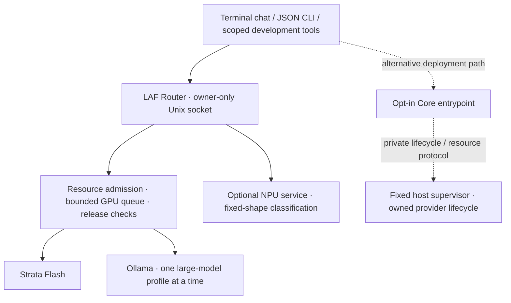

<!--
KISS Open License Version 1.0 (KOL-v1)

SPDX-FileCopyrightText: 2026 I-plusplus Inc.
SPDX-License-Identifier: LicenseRef-KOL-v1

Copyright remains with its respective holders; original copyright and attribution notices must be preserved.
Contributors may add copyright notices for their own original modifications.
Distributed modifications must be identified as required by Section 4(c) of KOL-v1.

Use, modification, distribution, and incorporation into commercial or proprietary software are permitted
without license fees or source disclosure, subject to all terms of the complete KOL-v1 license.

Contributors grant the patent permissions stated in KOL-v1. Outputs are not covered merely because a
KOL-licensed tool produced them; embedded licensed material remains subject to applicable license terms.

THIS SOFTWARE IS PROVIDED "AS IS", WITHOUT WARRANTY OR LIABILITY TO THE EXTENT PERMITTED BY APPLICABLE LAW.

This header is a summary, not a separate license or an amendment to KOL-v1.
All terms and conditions of KOL-v1 apply. See the accompanying LICENSE file for the complete license text.

Scope: This notice applies only to the project-authored metadata or documentation in this exact file. External material it describes retains its separate terms.
-->

<!-- Modified 2026-11-09: add the checkout-local interactive chat guide. -->

<!-- Modified 2026-11-10: redesign the landing page, document the default chat entrypoint, and move source-preview and test details into docs. -->

# Local AI Fabric

**Your hardware. Your models. Your AI.**

Local AI Fabric (LAF) coordinates local inference engines and development tools
through one private API. Use your own model assets while LAF checks resources,
switches models and handles recovery on your machine.

[Getting started](#getting-started) · [Architecture](#architecture) ·
[Project status](#project-status) · [Documentation](#documentation)

## Why LAF?

- **Local-first inference.** Talk to a Router through an owner-only Unix socket,
  without a cloud control plane or an exposed TCP listener.
- **Multiple execution engines.** Use Strata Flash and Ollama-backed large-model
  profiles through the same client and job API.
- **Resource-aware orchestration.** Check memory before admission, limit queued
  GPU work and confirm resources are released before switching models.
- **GPU and NPU integration.** Keep GPU generation separate from an optional,
  fixed-shape NPU classification service. An unavailable NPU does not block GPU jobs.
- **Development workflows.** Chat in the terminal, inspect or cancel jobs, and use
  opt-in, scoped repair and project tools with explicit file and execution limits.

**Current stage: source preview.** The control paths and clients are implemented,
with unit/mocked checks. This checkout does not ship model weights, vendor SDKs
or a ready-to-run runtime image, and does not establish hardware support. Start
with the offline path below, or follow the component guides for an already
provisioned host. See [source-preview limits and release gates](docs/source-preview.md).

## Architecture



The default Router manages the host-backed inference path. The opt-in Core
entrypoint separates inference control from fixed host lifecycle operations.
See [Core integration](docs/laf-core-integration.md) and
[the API contract](inference/local_platform/API.md) for those boundaries.

## How is this different from Ollama?

Ollama is an inference runtime used by LAF for its large-model profiles. LAF adds
a coordination layer across engines: a shared request API, resource admission,
model-switch and shutdown checks, an independent NPU lane, and bounded developer
clients. It uses Ollama rather than replacing it.

Start with standalone Ollama if you only need its model runtime. LAF is for
coordinating engines and guarded development workflows.

The current Router exposes three fixed generation profiles: `flash`, `coder-next`
and `gpt-oss-120b`. It is not an arbitrary-model launcher or a complete OpenAI API
emulator. See [Router behavior and limits](inference/laf_service/README.md).

## Getting started

### Explore the source without models

Use an existing Linux Python 3.10+ with `fcntl`, `resource` and Unix-process
support. This checkout includes a local launcher, not an installed package. From
the repository root, run:

```sh
./laf --help
./laf model catalog
printf '/help\n/quit\n' | ./laf
python3 -B scripts/check-laf.py --suite portable
```

These commands need no package installation, Docker, model download, vendor SDK
or running Router. They show the CLI, inspect the bundled catalog, exercise local
chat help/exit and run the portable unit/mocked checks. The catalog's default
entries intentionally cannot be installed until their metadata is verified.
The portable result accounts for socket tests as **unexecuted**, not passed;
see [test groups and result accounting](docs/testing.md).

Use `./laf` from the checkout; bare `laf` requires separate installation or a PATH
entry. If the launcher loses its executable bit during transfer, use
`python3 -B laf` with the same arguments.

### Connect to an existing Router

First complete the [Router prerequisites and host acceptance](inference/laf_service/README.md#machine-specific-preparation).
With that service at the client's default private socket, run:

```sh
./laf status
./laf
```

Running `./laf` without a subcommand opens chat using `gpt-oss-120b`. To choose
Flash explicitly, use:

```sh
./laf chat --model flash
```

The default socket is `/run/user/<uid>/laf-inference/service.sock`, using your
current user ID. `LOCAL_INFERENCE_SOCKET` can select another existing private
socket; an explicit `--socket` takes priority. See [the chat guide](docs/laf-chat-cli.md)
for custom-socket commands, filename-only workspace search, privacy and cancellation.
These client commands do not install or start a Router, engine or model. Chat
replies are unverified model output.

## Project status

- **Implemented in source:** guarded Router and JSON job API; Strata/Ollama
  adapters; terminal chat; bounded repair and scoped project tools; model catalog,
  registry and guarded Ollama management operations.
- **Opt-in source paths:** Core/host-supervisor separation and a fixed-shape NPU
  classifier. Real runtime, GPU/NPU and clean-host acceptance remain separate
  from software tests. Model acquisition and management also need verified
  operator inputs; the bundled catalog is not install-ready.
- **Future work:** packaged installation and complete runtime provisioning,
  distributable images, broader hardware acceptance, remote/multi-PC workflows,
  and a web UI. These are not shipped capabilities or promised release dates.

See [the full preview and release boundary](docs/source-preview.md) before
selecting a runtime configuration or distributing external assets.

## Documentation

- [Router setup, model switching and recovery](inference/laf_service/README.md)
- [Terminal conversation and filename search](docs/laf-chat-cli.md)
- [Development client](inference/local_platform/README.md) and
  [scoped project tools](inference/local_platform/workspace-client.md)
- [Model management and provenance](docs/laf-model-management.md)
- [Core integration](docs/laf-core-integration.md) and
  [fixed host supervisor](docs/laf-host-supervisor.md)
- [Optional NPU service](inference/laf_npu_service/README.md) and
  [NPU distribution requirements](inference/laf_npu_service/DISTRIBUTION.md)
- [Tests](docs/testing.md), [source-preview limits](docs/source-preview.md) and
  [naming/migration](inference/local_platform/naming.md)

## Contributing

Start with [the development rules](AGENTS.md) and [the offline checks](docs/testing.md).
Keep changes small, preserve the ownership and resource guards, and report what
you verified and what remains untested. Do not commit model data, credentials,
caches or logs.

## License

Identified first-party source is licensed under [KISS Open License v1.0](LICENSE)
(KOL-v1), a custom license with no claim of OSI approval. Read [the licensing
scope](LICENSING.md) and [third-party notices](THIRD_PARTY_NOTICES.md). External
engines, models and SDKs retain their own terms; this source license does not
grant rights to redistribute them.
