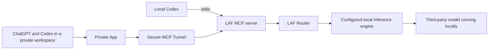

<!--
KISS Open License Version 1.0 (KOL-v1)

SPDX-FileCopyrightText: 2026 I-plusplus Inc.
SPDX-License-Identifier: LicenseRef-KOL-v1

Copyright remains with its respective holders; original copyright and attribution notices must be preserved.
Contributors may add copyright notices for their own original modifications.
Distributed modifications must be identified as required by Section 4(c) of KOL-v1.

Use, modification, distribution, and incorporation into commercial or proprietary software are permitted
without license fees or source disclosure, subject to all terms of the complete KOL-v1 license.

Contributors grant the patent permissions stated in KOL-v1. Outputs are not covered merely because a
KOL-licensed tool produced them; embedded licensed material remains subject to applicable license terms.

THIS SOFTWARE IS PROVIDED "AS IS", WITHOUT WARRANTY OR LIABILITY TO THE EXTENT PERMITTED BY APPLICABLE LAW.

This header is a summary, not a separate license or an amendment to KOL-v1.
All terms and conditions of KOL-v1 apply. See the accompanying LICENSE file for the complete license text.

Scope: This notice applies only to the project-authored metadata or documentation in this exact file. External material it describes retains its separate terms.
-->

<!-- Modified 2026-11-09: add the checkout-local interactive chat guide. -->

<!-- Modified 2026-11-10: redesign the landing page, document the default chat entrypoint, and move source-preview and test details into docs. -->

<!-- Modified 2026-11-10: link client-only packaging while retaining the separate runtime-provisioning boundary. -->

<!-- Modified 2026-11-22: summarize requirements and the two source setup paths. -->

<!-- Modified 2026-11-22: describe client roles, local inference, and example hardware. -->

# Local AI Fabric

**Your hardware. Your models. Your AI.**

ChatGPT and Codex are control clients for Local AI Fabric (LAF). They send
requests to LAF over MCP. The LAF Router can pass inference requests to a
configured engine running a third-party model on your hardware. LAF ships
without model weights. Obtain the model artifact separately.

`0.0.1` is an experimental source preview. Public one-click plugin installation
is unavailable for this version.

## Requirements

- A Linux host for the documented setup and Python 3.12 or later for the LAF
  runtime.
- [MCP SDK 1.30.0](docs/laf-sdk-install.md) for the plugin frontend. The SDK
  installer supports CPython 3.12 and 3.14 on Linux x86_64.
- RAM and disk space for the engine and model you choose. The documented
  CPU-only example uses a digest-pinned Ollama image and model manifest.

## Hardware and model examples

Host CPU core counts and installed capacities are planning examples.

| Path | CPU | System DRAM | Dedicated GPU VRAM | Model and Ollama download |
| --- | --- | --- | --- | --- |
| [CPU-only with local Docker](docs/laf-configured-models.md#explicit-cpu-only-router) | x86-64, about 4 host cores. The example container is capped at 1 CPU. | 16 GiB installed as a planning example. Cold start checks 8 GiB of available host RAM in addition to the 1 GiB container cap. | None needed | [SmolLM2-135M-Instruct][smollm2-card], [Q4_K_M (105 MB)][smollm2-tag] |
| [AMD GPU candidates (untested)](docs/laf-provider-portability.md#8-16-gb-vram-the-next-bounded-path) | x86-64, about 4 host cores | The current GPU path checks at least 8 GiB available. | 8-16 GB nominal candidate range. The current guard checks at least 2 GiB free. | [Qwen2.5-Coder-1.5B-Instruct][qwen15-card], [Q4_K_M (986 MB)][qwen15-tag]<br>[Qwen2.5-Coder-7B-Instruct][qwen7-card], [Q4_K_M (4.7 GB)][qwen7-tag] |

The listed sizes are downloads. Shared graphics memory draws from system DRAM.
For the GPU candidates, verify device and driver compatibility and measure DRAM
and VRAM headroom during model load and generation. The
[CPU-only smoke test](https://github.com/i-pp/laf/pull/25) recorded one
completed SmolLM2 job with zero VRAM reported by the provider.

[smollm2-card]: https://huggingface.co/HuggingFaceTB/SmolLM2-135M-Instruct
[smollm2-tag]: https://ollama.com/library/smollm2:135m-instruct-q4_K_M
[qwen15-card]: https://huggingface.co/Qwen/Qwen2.5-Coder-1.5B-Instruct
[qwen15-tag]: https://ollama.com/library/qwen2.5-coder:1.5b-instruct-q4_K_M
[qwen7-card]: https://huggingface.co/Qwen/Qwen2.5-Coder-7B-Instruct
[qwen7-tag]: https://ollama.com/library/qwen2.5-coder:7b-instruct-q4_K_M

## Architecture



See the [component guide](docs/public-source-component-guide.md) for the
standalone client and other components.

## Set up from source

1. Check out the experimental source tag.

   ```sh
   git clone --branch 0.0.1 --single-branch https://github.com/i-pp/laf.git
   cd laf
   ```

2. [Select or install a model](docs/laf-model-management.md#model-setup-from-the-local-ai-fabric-plugin)
   and [configure and start its Router](docs/laf-configured-models.md).
   Keep weights in persistent storage outside the plugin. Install the SDK, then
   [prepare a private LAF runtime and bind it to the Router](docs/bootstrap.md).
3. Choose a connection.
   - **Local Codex.** Follow the [local marketplace instructions](docs/codex-install.md#codex-local-marketplace-option)
     to install the source-built plugin and connect over stdio.
   - **Private workspace.** Follow the [workspace setup guide](docs/integrated-plugin-install.md#private-workspace-setup-for-001)
     to connect ChatGPT and Codex through one private App and its Secure MCP
     Tunnel.
4. With the Router running, use `laf_router_status` in the connected plugin or
   run this command from the checkout with your Router's socket path.

   ```sh
   ./laf --socket /absolute/owner-private/router/service.sock status
   ```

   Look for `ready` in the returned status.
